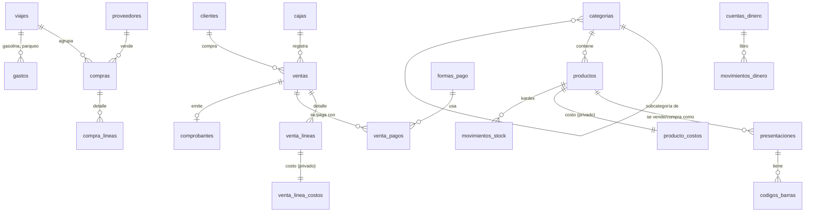

# Plan de trabajo y modelo de datos — Sandry (app web)

Estado: **aprobado** (28/10/2026), con estos cambios: hosting en **Netlify** (no Vercel),
dominio propio se decide en la fase 7, y la **fase 7 se hace al final**, después de la 8.
Orden real: 1 → 2 → 3 → 4 → 5 → 6 → 8 → 7.

| Fase | Estado |
|---|---|
| 1. Preparación | ✅ Aprobada el 28/10/2026 — https://storied-raindrop-2de6ba.netlify.app |
| 2. Usuarios | ✅ Aprobada el 28/10/2026 |
| 3. Catálogo | ✅ Aprobada el 29/10/2026 (ver docs/FASE-3.md) |
| 4. Abastecimiento e inventario | ✅ Aprobada el 29/10/2026, probada en la PC (en la web se publica el 28/11/2026, al renovarse los créditos de Netlify) |
| 5. Punto de venta | ✅ Aprobada el 30/10/2026 (probada en la PC) |
| 6. Gastos y reportes | Lista para probar en la PC (ver docs/FASE-6.md) |

---

## 1. Plan por fases

Cada fase termina con: la app funcionando y publicada, pruebas automáticas de lo
importante, una lista de "cómo probarlo tú mismo" y una pausa para tu aprobación.

| Fase | Qué se entrega | Cómo sabes que está lista |
|---|---|---|
| **1. Preparación** | Instalar Node y git, crear cuentas (GitHub, Supabase, Netlify, Resend), crear el proyecto vacío con su estructura, PWA básica (ícono, se puede instalar), aviso de "sin conexión", y primer despliegue. | Abres un enlace `https://...netlify.app` en el celular, ves la pantalla de Sandry y la puedes "Agregar a pantalla de inicio". |
| **2. Usuarios** | Registro (el primero queda como administradora), aprobación de nuevos, login con "Recordarme", recuperar contraseña y correo, roles con casillas de permisos, PIN para cambiar de usuaria, desactivar usuarias, cierre por inactividad y bitácora. | Te registras, registras a una "trabajadora" de prueba, la apruebas, y compruebas que ella NO ve lo que no debe. |
| **3. Catálogo** | Categorías en árbol, productos, presentaciones (unidad, funda, jaba, libra…), precios con margen, códigos internos (PLU), códigos de barras internos, etiquetas, hoja de códigos plastificable, plantilla Excel e importación de productos. | Cargas 20 productos por Excel, imprimes una hoja de etiquetas y una hoja de códigos. |
| **4. Abastecimiento e inventario** | Proveedores y lugares, cuentas de dinero, recepción de distribuidor, viaje de compras desde el celular, compra suelta, compras por Excel, transporte (gasto o prorrateo), comparador de precios, costo promedio, kardex, ajustes, caducidades, alertas, lista de compras sugerida y envases. | Haces un viaje de compras de prueba en el celular (incluso en modo avión) y al "recibir en tienda" el stock y el costo cambian bien. |
| **5. Punto de venta** | Lector USB/Bluetooth y cámara, búsqueda tolerante, botones por categoría, presentaciones y peso, formas de pago (efectivo, Deuna, transferencia, tarjeta, fiado, mixto), caja con apertura/cierre/arqueo, clientes y fiados, tickets 58/80 mm y WhatsApp. **Aquí te recomiendo qué lector e impresora comprar.** | Vendes con la cámara del celular y con el teclado de la PC, cierras la caja y cuadra. |
| **6. Gastos y reportes** | Gastos y recurrentes, vehículo (% tienda/personal), panel de inicio, ganancia bruta y neta, flujo de caja por cuenta, reportes por categoría/producto/hora/trabajadora, exportar a Excel y PDF. | Ves cuánto ganó la tienda hoy, esta semana y este mes. |
| **7. Comprobantes** | Ticket interno ("Documento sin valor tributario") — que es lo que hoy necesitas por estar **Sin RUC**. Consumidor final / con datos, nota de venta (Negocio Popular) y factura electrónica en el **ambiente de pruebas** del SRI, con RIDE y envío por correo, quedan listos para cuando cambie el régimen. | Emites una factura de prueba que el SRI de pruebas autoriza. |
| **8. Extras y pulido** | Promociones (3x$1, 2x1…), actualización masiva de precios, recordatorios por WhatsApp, búsqueda por voz, respaldos automáticos, manual de uso para tu mamá y la trabajadora, revisión de seguridad y rendimiento, y comando para borrar los datos de prueba. | Tu mamá sigue el manual sola y puede vender, comprar y ver su ganancia. |

> Nota: la especificación dice que el ticket se elige "al cobrar" (fase 5). En la fase 5
> ya saldrá el ticket interno; la fase 7 agrega los comprobantes tributarios.

### Estructura de carpetas (fase 1)

```
tienda-web/
├─ docs/                  especificación, plan, manual de uso
├─ supabase/
│  ├─ migrations/         creación de tablas, permisos y reglas RLS (en SQL)
│  └─ seed.sql            datos de prueba de una tienda ecuatoriana
├─ src/
│  ├─ app/                pantallas (POS, inventario, compras, reportes, ajustes…)
│  ├─ components/         piezas de pantalla reutilizables (botones, tablas…)
│  ├─ lib/
│  │  ├─ dinero.ts        cálculos con decimales exactos
│  │  ├─ textos.ts        todos los textos de la interfaz
│  │  ├─ escaner/         lector USB, Bluetooth y cámara
│  │  ├─ sri/             facturación electrónica (solo servidor)
│  │  └─ excel/           plantillas, importar y exportar
│  └─ server/             acciones que corren solo en el servidor
├─ tests/                 pruebas (Vitest) y flujos (Playwright)
├─ public/                íconos y manifest de la PWA
└─ CLAUDE.md              reglas del proyecto
```

---

## 2. Modelo de datos explicado sencillo

Piensa en la base de datos como un conjunto de **cuadernos**. Cada cuaderno (tabla)
guarda una sola clase de cosa, y los cuadernos se "señalan" entre sí. Hay dos cuadernos
centrales que hacen que los números siempre cuadren:

- **El kardex (`movimientos_stock`)**: cada vez que entra o sale mercadería (venta,
  compra, merma, autoconsumo, ajuste), se escribe una línea. El stock de un producto es
  la suma de sus líneas.
- **El libro de dinero (`movimientos_dinero`)**: cada vez que entra o sale plata de una
  cuenta (caja, banco, Deuna, dinero personal de la dueña), se escribe una línea. El
  saldo de cada cuenta es la suma de sus líneas.

Nada se borra: si algo se anula, se escribe una línea que lo revierte. Así siempre se
puede saber quién hizo qué y cuándo.

### 2.1 Personas y permisos

| Tabla | Qué guarda |
|---|---|
| `perfiles` | Cada persona: nombre, correo, teléfono, cédula, foto, rol, estado (pendiente / activa / desactivada), PIN cifrado. |
| `roles` y `permisos_rol` | Administradora, Cajera, Encargada de inventario, y qué casillas tiene marcadas cada rol (ver costos, cambiar precios, recibir mercadería, % de descuento máximo…). |
| `bitacora` | Quién cambió precios, anuló ventas, ajustó stock, aprobó descuentos o cambió permisos, y cuándo. |
| `ajustes` | Datos de la tienda: nombre, logo, QR de Deuna, datos bancarios, límites (consumidor final, descuento, inactividad), régimen tributario, etc. |

### 2.2 Catálogo

| Tabla | Qué guarda |
|---|---|
| `categorias` | Árbol de categorías (cada una puede tener una "madre"), color/ícono, IVA por defecto y margen objetivo. |
| `productos` | Nombre, marca, categoría, unidad base (unidad, libra, kilo, litro), PLU, apodos para buscar, foto, IVA, stock mínimo, si caduca, si es retornable, si es +18, ubicación, activo. |
| `presentaciones` | Las formas de vender/comprar un producto: unidad, funda x100, jaba x12, libra… con su **factor** a la unidad base y su **precio de venta** propio. |
| `codigos_barras` | Cada código apunta a un producto y a una presentación (así escanear la caja agrega la jaba entera). Un producto puede tener varios. |
| `producto_costos` 🔒 | Costo promedio actual de cada producto. **Solo la ven quienes tienen permiso.** |
| `historial_precios` | Cada cambio de precio de venta y de costo, con fecha y usuaria. |
| `promociones` | 3 por $1, 2x1, precio especial por fecha u horario (fase 8). |
| `etiquetas_por_imprimir` | Productos cuyo precio cambió y necesitan etiqueta nueva. |

### 2.3 Dinero

| Tabla | Qué guarda |
|---|---|
| `cuentas_dinero` | Caja, Caja fuerte, Banco(s), Deuna, Dinero personal de la dueña. |
| `movimientos_dinero` | El libro: fecha, cuenta, monto (+ entra / − sale), motivo (venta, compra, gasto, abono, transferencia, aporte de la dueña, retiro de la dueña) y a qué cosa se refiere. |
| `formas_pago` | Efectivo, Deuna, Transferencia, Tarjeta, Fiado… cada una ligada a una cuenta y a su código del SRI. |

### 2.4 Proveedores y compras

| Tabla | Qué guarda |
|---|---|
| `proveedores` | Distribuidores, mayoristas, mercados, supermercados: tipo, RUC opcional, teléfono/WhatsApp, días de visita, condiciones de pago. |
| `pedidos` y `pedido_lineas` | Lo que se le pide al preventista (opcional). |
| `viajes` | Un viaje de compras en el carro: fecha, estado (en curso / recibido), cómo se trata el transporte (gasto o prorrateo). |
| `compras` | Cada compra: proveedor/lugar, viaje (si fue en un viaje), con o sin factura, número y foto de factura, contado o crédito, cuenta de la que se pagó. |
| `compra_lineas` | Producto, presentación, cantidad, costo, bonificación (costo 0), dañados. |
| `cuentas_por_pagar` y `pagos_proveedor` | Lo que se debe a crédito, fecha de vencimiento y abonos. |

### 2.5 Inventario

| Tabla | Qué guarda |
|---|---|
| `movimientos_stock` | **El kardex**: producto, cantidad en unidad base (+/−), costo, motivo (venta, compra, merma, caducado, robo, autoconsumo, regalo, conteo), usuaria y saldo. |
| `lotes` | Cantidades con fecha de caducidad, para avisar "por caducar" y vender primero lo que vence antes. |
| `conteos` y `conteo_lineas` | Tomas de inventario: lo que dice el sistema vs. lo que se contó; la administradora aprueba los ajustes. |
| `movimientos_envases` | Jabas y botellas: vacíos en tienda, debidos al proveedor, garantías cobradas y devueltas. |

### 2.6 Ventas, caja y clientes

| Tabla | Qué guarda |
|---|---|
| `cajas` | Cada turno: quién la abrió, fondo inicial, cierre, arqueo por billetes y monedas, sobrante/faltante. |
| `ventas` | Fecha y hora, usuaria, caja, cliente, totales, IVA, descuento, estado (normal / anulada), tipo de comprobante. |
| `venta_lineas` | Producto, presentación, cantidad, precio cobrado, descuento, IVA. |
| `venta_linea_costos` 🔒 | El **costo de cada línea en el momento de la venta**, para calcular la ganancia real. Solo para quien tiene permiso. |
| `venta_pagos` | Cómo se pagó (puede ser mixto): forma de pago, monto, número de transacción Deuna/transferencia/voucher, foto. |
| `devoluciones` | Qué se devolvió, por qué y quién lo autorizó (devuelve el stock). |
| `productos_pendientes` | Productos vendidos "sin registrar" que la administradora debe completar. |
| `clientes` | Cédula/RUC/pasaporte, nombre, contacto, límite de crédito, "pedido de siempre". |
| `fiados` / `abonos` | Lo que debe cada cliente y lo que va pagando. |

### 2.7 Gastos y vehículo

| Tabla | Qué guarda |
|---|---|
| `categorias_gasto` | Transporte (gasolina, parqueadero…), servicios básicos, arriendo, sueldos, etc. |
| `gastos` | Monto, categoría, cuenta de la que salió, foto del recibo, viaje (si es de un viaje), vehículo, parte "tienda" vs. "personal". |
| `gastos_recurrentes` | Arriendo, luz, internet, sueldos, con recordatorio mensual. |
| `vehiculos` | El carro, su % de uso para la tienda y sus cargas de gasolina. |

### 2.8 Comprobantes (fase 7)

| Tabla | Qué guarda |
|---|---|
| `comprobantes` | Tipo (ticket interno, nota de venta, factura, nota de crédito), número, clave de acceso, estado ante el SRI, mensajes de error, enlaces al XML y al RIDE (7 años). |
| `secuenciales` | El siguiente número por establecimiento y punto de emisión. |

La firma electrónica (.p12) se guarda cifrada en el servidor, fuera de cualquier tabla
que el navegador pueda leer.

### 2.9 Cómo se relacionan (lo principal)



### 2.10 Ejemplo para entenderlo

Tu mamá compra **2 jabas de Coca-Cola 500 ml a $9.00 cada una** pagando con la caja:

1. `compras` + `compra_lineas`: 2 × "jaba x12" a $9.00.
2. `movimientos_stock`: entran 24 unidades (2 × 12) a $0.75 cada una.
3. `producto_costos`: se recalcula el costo promedio.
4. `movimientos_dinero`: sale $18.00 de la cuenta "Caja".

Luego vende **1 Coca-Cola a $1.00** cobrada por Deuna:

1. `ventas` + `venta_lineas`: 1 unidad a $1.00; `venta_linea_costos`: $0.75.
2. `movimientos_stock`: sale 1 unidad.
3. `venta_pagos` + `movimientos_dinero`: entra $1.00 a "Deuna".
4. Ganancia de esa venta: $1.00 − $0.75 = **$0.25** (solo la administradora la ve).

---

## 3. Cosas a confirmar

### Necesito tu decisión

1. **Vercel gratis es solo para uso personal, no comercial.** Sus condiciones dicen
   que el plan Hobby es para uso personal y no comercial, y una tienda es un negocio.
   Opciones: (a) usarlo igual al inicio, con el riesgo de que lo suspendan; (b) Vercel
   Pro, 20 USD/mes; (c) otro hosting gratuito que sí permite uso comercial y funciona
   con Next.js (p. ej. Netlify o Cloudflare). Mi recomendación: **(c) Netlify**, porque
   no cambia nada del código.
2. **Correos a clientes necesitan un dominio propio.** Resend gratis (3.000 correos al
   mes, 100 al día) solo permite enviar a cualquier correo si tienes un dominio
   verificado (p. ej. `tiendasandry.com`, unos 10–15 USD al año). Sin dominio solo
   funciona el correo de recuperación de contraseña por el sistema de Supabase, con
   límites muy bajos. Como hoy estás Sin RUC y no envías facturas, se puede postergar
   hasta la fase 7. ¿Lo compramos ahora, después, o nunca?
3. **Orden de la fase 7.** Como la tienda está Sin RUC, la factura electrónica no se usa
   hoy. ¿La dejo para el final (después de la fase 8), o la hago en su lugar como dice la
   especificación?

### Lo verificaré en el SRI cuando lleguemos a la fase 7 (y te aviso)

- Límite de venta a consumidor final ($50) y si es distinto para Negocio Popular.
- Leyendas vigentes para RIMPE Negocio Popular y Emprendedor, y cómo se emiten hoy las
  notas de venta.
- Tabla de formas de pago del SRI, anulaciones y notas de crédito a consumidor final.
- Regla de compras mayores a $500 por el sistema financiero y sustento con factura.
- Si la resolución NAC-DGERCGC26-00000027 (registro de proveedores de sistemas de
  facturación) afecta a un sistema hecho para uso propio.
- Que la tienda no calcule ICE.

> Aviso amable: en Ecuador, por lo general, quien vende de forma habitual debe tener RUC
> o estar en el RIMPE. Conviene que tu mamá lo confirme con un contador. El sistema
> queda listo para cambiar de régimen con un clic en Ajustes.

### Límites de los planes gratuitos (para que lo sepas)

- **Supabase gratis**: 500 MB de base de datos y 1 GB de archivos (fotos y recibos).
  Alcanza para años si las fotos se comprimen, cosa que haré. Pausa el proyecto si pasa
  una semana sin uso (con uso diario no pasa) y **no incluye copias de seguridad
  automáticas**, por eso los respaldos de la fase 8 son importantes.
